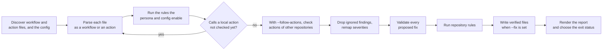

# How crosgha works

crosgha has one analysis path. The CLI runs it, and so do the pre-push hook and the GitHub Action, which both call the
CLI binary: neither contains a second detector or fixer.

## What gets scanned

Without a path, crosgha scans `.github/workflows`. Each path you pass may be a workflow file, an action file, a
directory of workflows, a repository root, or its `.github`. Subdirectories below `.github/workflows` are never scanned,
because GitHub does not load workflows from them.

A file named `action.yml` or `action.yaml` is an action metadata file, unless it sits in `.github/workflows`, where it
is a workflow. An action file is scanned when you name it as a path, and also when the scanned repository runs or
publishes it: the root `action.yml`, and every local action a scanned workflow calls with `uses: ./path`, followed
through the composite actions those call in turn. A composite action's `runs.steps` get the rules that read steps,
`uses` lines, or text; JavaScript and Docker actions get the metadata checks only. Rules about triggers, jobs,
`permissions`, timeouts, or `defaults` never run on an action file.

`--follow-actions` also reads the actions that steps call as `uses: owner/repo/path@ref`. Each ref is resolved to a
commit first; crosgha reads `action.yml` or `action.yaml` at that commit, checks it with the offline action rules
without the remote action's own ignore comments, and follows its composite calls. It needs a token, spends GitHub API
requests, and never fixes anything, since the file belongs to another repository. Details and request costs:
[Usage](usage.md#actions-from-other-repositories).

`crosgha owner/repo@ref` scans a GitHub repository without a clone, at one commit, with the same rules as a local copy.
It needs a token, and `--offline` and `--fix` reject it ([Usage](usage.md#remote-repositories)).

## How a file is checked



A workflow must have the top-level keys `on` and `jobs`, with `jobs` a mapping; an action must have a `runs` mapping with
a string `runs.using`. A file that fails this is reported on stderr, the other files are still checked, the run exits
with status 2, and `--fix` writes nothing. Other schema mistakes, such as a composite `run` step without `shell`, are
ordinary findings of the `schema-validity` rule.

Each rule has one of three scopes:

| Scope | What it reads | Count |
|---|---|---|
| `workflow` | One workflow or action file: triggers, jobs, steps, `uses` lines, scripts | 43 |
| `repository` | The repository around the scanned files, such as `.github/dependabot.yml` and the security workflows it runs | 3 |
| `online` | The GitHub API: advisories, tags, archived repositories, Actions settings | 5 |

Online rules, and the repository rule `repo-org-settings`, run only when a token is available (`--gh-token`,
`GH_TOKEN`, or `GITHUB_TOKEN`). `--offline` turns them off, and `--no-online-audits` skips the online rules while
leaving the rest. A failed API call skips only the checks that needed that answer, and the run exits 2, so a CI gate
does not pass on checks that never ran. The full list is the [rule catalog](rules.md).

Each rule declares the lowest persona that runs it, and each persona includes the ones above it:

| Persona | Adds | Example from this repository |
|---|---|---|
| `regular` (default) | High-signal security findings | `script-injection` |
| `pedantic` | Code smells and hardening policies: pinning, timeouts, permissions, triggers | `unpinned-action`, `missing-timeout` |
| `auditor` | Heuristics likely to include false positives: complexity, readability | `workflow-level-permissions` |

`--min-severity` then hides findings below a threshold on zizmor's scale, `informational`/`low` → note, `medium` →
warning, `high` → error; it hides a finding, it does not change the rule it comes from.

`--fail-on` defaults to `any`, so any reported finding fails the run; `--fail-on warning` fails only from warnings up, and
`--fail-on none` never fails on findings. Under `--fix` the threshold judges the findings that remain after the fixes
are applied. Status 1 means a finding reached the threshold, and status 2 means a path, a workflow, a config, or an API
call failed ([Output and exit status](output.md)).

## How a fix is accepted

A fix proposal touches one YAML node. crosgha writes it only when all three of these hold
([Fixes](fixes.md)):

1. The patched file parses, and its workflow or action structure is still valid.
2. Every enabled rule runs again: the targeted finding is gone, and no new finding appeared.
3. Only the intended YAML node changed, byte for byte, comments and spacing included. A replaced value is swapped
   back and must restore the original source; an added key must be the only insertion; a removed key the only deletion.

When one of them fails, that proposal is skipped: the finding stays in the report with the reason it was not applied,
and the other proposals still run. Two cases reach this often. A value shared through a YAML anchor (`&name`) is never
rewritten, because that would change every alias (`*name`). And a rewrite that would introduce another finding is
refused: `unsafe-if-condition` leaves a bot check alone, because the check becomes spoofable once it is evaluated.

All files are prepared before any is written, and each file is written through a temporary file in the same directory.
A symlinked workflow, or one reached through a symlinked directory below the scanned path, is reported but never
rewritten. CRLF line breaks and a missing final newline are kept. Every other rule is detection-only, because choosing
a SHA, a timeout, or a token scope needs project context.

This is one real run on a workflow whose checkout keeps its token for later steps. The file:

```yaml
on: push

permissions:
  contents: read

jobs:
  build:
    runs-on: ubuntu-24.04
    timeout-minutes: 5
    steps:
      - uses: actions/checkout@3d3c42e5aac5ba805825da76410c181273ba90b1 # v7.0.1
      - run: make build
```

```console
$ crosgha --offline --persona pedantic --fix .github/workflows/build.yml
note[broad-trigger]: `push` has no branch, tag, or path filter
 --> .github/workflows/build.yml:1:1
  |
1 | on: push
  | ^^ workflow
  |
  = help: push and pull_request triggers should filter branches, tags, or paths.

note[missing-concurrency]: superseded runs keep running without a concurrency group
 --> .github/workflows/build.yml:1:1
  |
1 | on: push
  | ^^ workflow
  |
  = help: CI workflows should cancel superseded runs with a concurrency group.
  = note: same as zizmor: concurrency-limits

Fixed 1 finding in 1 workflow file.
Remaining: 2 findings (2 notes).
```

The two notes are detection-only rules, so they stay. The `persist-credentials` finding and its block are gone from
the report, and the file now holds the added input:

```yaml
on: push

permissions:
  contents: read

jobs:
  build:
    runs-on: ubuntu-24.04
    timeout-minutes: 5
    steps:
      - uses: actions/checkout@3d3c42e5aac5ba805825da76410c181273ba90b1 # v7.0.1
        with:
          persist-credentials: false
      - run: make build
```

Which rules have a fix, and what each one leaves unfixed: [Fixes](fixes.md).

## Where results go

The same findings render in five formats, chosen with `--format`. Under `GITHUB_ACTIONS=true`, `github` is the default
instead of `text`, and `--sarif-file FILE` writes SARIF alongside any format, so one run serves both the log and the
Security tab.

The same workflow as it was before the fix, reported in each format:

`text` (the default) prints one rustc-style diagnostic per finding, with the source line underlined:

```console
$ crosgha --offline --persona pedantic .github/workflows/build.yml
note[broad-trigger]: `push` has no branch, tag, or path filter
 --> .github/workflows/build.yml:1:1
  |
1 | on: push
  | ^^ workflow
  |
  = help: push and pull_request triggers should filter branches, tags, or paths.

note[missing-concurrency]: superseded runs keep running without a concurrency group
 --> .github/workflows/build.yml:1:1
  |
1 | on: push
  | ^^ workflow
  |
  = help: CI workflows should cancel superseded runs with a concurrency group.
  = note: same as zizmor: concurrency-limits

warning[persist-credentials]: checkout retains credentials for later steps
  --> .github/workflows/build.yml:11:9
   |
11 |       - uses: actions/checkout@3d3c42e5aac5ba805825da76410c181273ba90b1 # v7.0.1
   |         ^^^^ job `build`, step 1
   |
   = help: actions/checkout must not leave the token on disk for later steps; there is no automatic fix when a later step pushes with it, `true` is explicit, or the checkout predates v2.
   = note: same as zizmor: artipacked

Checked 1 workflow file: 3 findings (1 warning, 2 notes).
1 finding has a fix: rerun with --fix.
```

`json` is versioned, with a `summary` and one object per finding, so a script can read it:

```console
$ crosgha --offline --persona pedantic -f json .github/workflows/build.yml
{
  "errors": [],
  "findings": [
    ...
    {
      "column": 9,
      "end_column": 13,
      "end_line": 11,
      "equivalents": [
        {
          "rule": "artipacked",
          "tool": "zizmor"
        }
      ],
      "line": 11,
      "location": "job `build`, step 1",
      "message": "checkout retains credentials for later steps",
      "path": ".github/workflows/build.yml",
      "rule": "persist-credentials",
      "severity": "warning",
      "tag": "persist-credentials"
    }
  ],
  "fixes": [],
  "summary": {
    "errors": 0,
    "files": 1,
    "findings": 3,
    "fixed": 0,
    "referenced_actions": 0
  },
  "tool": {
    "name": "crosgha",
    "version": "0.26.1"
  },
  "version": 1
}
```

`sarif` is SARIF 2.1.0 with the rule metadata GitHub code scanning requires. The `rules` array carries all 51 rules,
with their descriptions and help, so the sample is trimmed:

```console
$ crosgha --offline --persona pedantic -f sarif .github/workflows/build.yml
{
  "$schema": "https://json.schemastore.org/sarif-2.1.0.json",
  "runs": [
    {
      "columnKind": "utf16CodeUnits",
      "invocations": [
        {
          "executionSuccessful": true,
          "toolExecutionNotifications": []
        }
      ],
      "results": [
        ...
        {
          "level": "warning",
          "locations": [
            {
              "physicalLocation": {
                "artifactLocation": {
                  "uri": ".github/workflows/build.yml"
                },
                "region": {
                  "endColumn": 13,
                  "endLine": 11,
                  "startColumn": 9,
                  "startLine": 11
                }
              }
            }
          ],
          "message": {
            "text": "job `build`, step 1: checkout retains credentials for later steps"
          },
          "ruleId": "persist-credentials",
          "ruleIndex": 18
        }
      ],
      "tool": {
        "driver": {
          "informationUri": "https://github.com/reset-ufc/crosgha",
          "name": "crosgha",
          ...
          "rules": [
            ...
          ],
          "version": "0.26.1"
        }
      }
    }
  ],
  "version": "2.1.0"
}
```

`github` prints workflow-command annotations, which GitHub renders on the pull request's diff:

```console
$ crosgha --offline --persona pedantic -f github .github/workflows/build.yml
::notice file=.github/workflows/build.yml,line=1,endLine=1,col=1,endColumn=3,title=broad-trigger::workflow: `push` has no branch, tag, or path filter
::notice file=.github/workflows/build.yml,line=1,endLine=1,col=1,endColumn=3,title=missing-concurrency::workflow: superseded runs keep running without a concurrency group (zizmor: concurrency-limits)
::warning file=.github/workflows/build.yml,line=11,endLine=11,col=9,endColumn=13,title=persist-credentials::job `build`, step 1: checkout retains credentials for later steps (zizmor: artipacked)
```

`agent` prints one line per finding, for an AI agent or a log that is read by one:

```console
$ crosgha --offline --persona pedantic -f agent .github/workflows/build.yml
.github/workflows/build.yml:1:1: note broad-trigger: workflow: `push` has no branch, tag, or path filter help: push and pull_request triggers should filter branches, tags, or paths.
.github/workflows/build.yml:1:1: note missing-concurrency: workflow: superseded runs keep running without a concurrency group (zizmor: concurrency-limits) help: CI workflows should cancel superseded runs with a concurrency group.
.github/workflows/build.yml:11:9: warning persist-credentials: job `build`, step 1: checkout retains credentials for later steps (zizmor: artipacked) help: actions/checkout must not leave the token on disk for later steps; there is no automatic fix when a later step pushes with it, `true` is explicit, or the checkout predates v2.
```

Every format but SARIF counts columns in characters, and colors only the `text` output, on a terminal or with
`--color always`. Exit status 0 means nothing reached `--fail-on`, 1 means something did, and 2 means an input, a
parse, a config, a write, or an API call failed; the files that did parse are still reported
([Output and exit status](output.md)).

## Coming from zizmor

crosgha reads `zizmor.yml` when no `crosgha.yml` is present, finds it in the same order, honors `# zizmor: ignore[...]`
comments, accepts zizmor's rule names in `disable`, `ignore`, and remaps, and names the equivalent zizmor or
actionlint rule next to a finding when one exists. Personas are zizmor's, `--pedantic` works as an alias for
`--persona pedantic`, and `--min-confidence` is accepted and changes nothing, since findings carry no confidence level.
A `rules.<id>` entry for a zizmor rule crosgha does not have is ignored with a warning rather than failing the run, so
an existing file keeps working. What differs is the exit status of a failed run: 0, 1, and 2 instead of zizmor's 11–14.
The schema, the discovery order, and what each key does: [Configuration](configuration.md). Migrating Action steps and
shell steps, including `crosgha migrate`'s view of zizmor, actionlint, poutine, ghalint, and octoscan:
[Usage](usage.md#migrating-from-zizmor-actionlint-poutine-ghalint-or-octoscan).

## Our detection is our own

crosgha never embeds, vendors, or shells out to another detector. No zizmor, actionlint, poutine, or ghalint crate runs
inside it for finding smells or validating fixes, and none of them runs on this repository's own workflows: crosgha
checks those in CI and in the pre-push hook. Each rule's concept and primary source are cited above the rule, the list
of untrusted contexts comes from GitHub's documentation, and the compatibility layer only reads another tool's config
format, accepts its rule IDs, and rewrites its Action step in `migrate`.
